# Suzanne

> Application auto-hébergée de finances personnelles : comptes, opérations, budgets, PEA et placements, rapprochement avec les relevés bancaires. Pour un foyer, sur un réseau privé.

Suzanne répond à des questions simples : *combien j'ai dépensé ce mois-ci et où, combien il me reste à dépenser jusqu'à la fin du mois, est-ce que mes comptes collent au centime avec mes relevés, combien vaut mon PEA aujourd'hui ?*

Interface en **français et en anglais**, pensée d'abord pour le mobile.

📖 Pour apprendre à s'en servir : [guide d'utilisation](docs/UTILISATION.md).

---

## Captures d'écran

> Données entièrement fictives (profil « Démo », générées par `tools/demo-data.mjs`).


<sub>**Accueil** : valeur nette, flux du mois, budget restant, échéances à venir, où part l'argent.</sub>

<table>
<tr>
<td width="50%"><br><sub><b>Journal</b> : filtres combinables, tags, pointage, ventilation, remboursements, actions en lot.</sub></td>
<td width="50%"><br><sub><b>Budgets</b> : budget du mois et « reste à vivre » par jour, enveloppes par catégorie, provisions.</sub></td>
</tr>
<tr>
<td width="50%">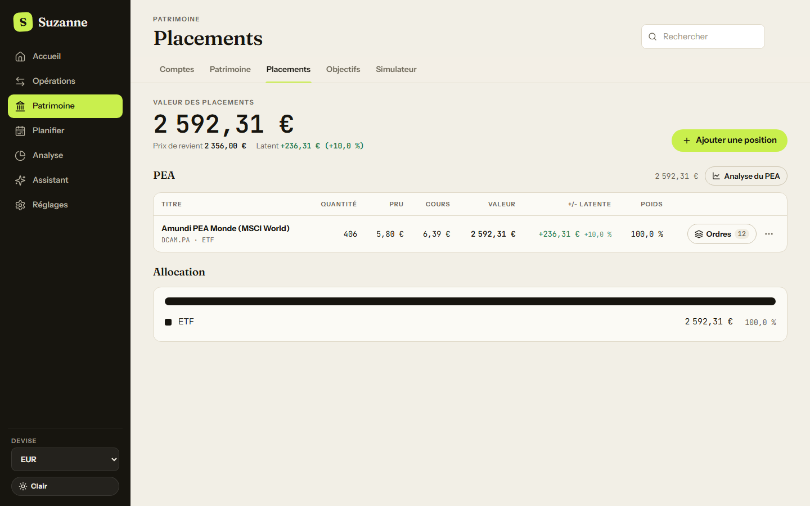<br><sub><b>Placements</b> : positions valorisées chaque jour aux cours Yahoo Finance, PRU, plus-values.</sub></td>
<td width="50%">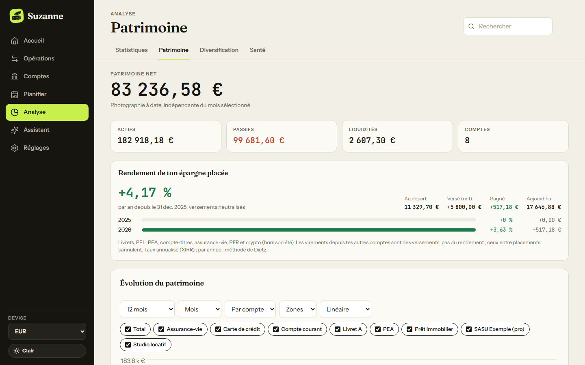<br><sub><b>Patrimoine</b> : évolution de la valeur nette, répartition par compte et par type.</sub></td>
</tr>
<tr>
<td width="50%">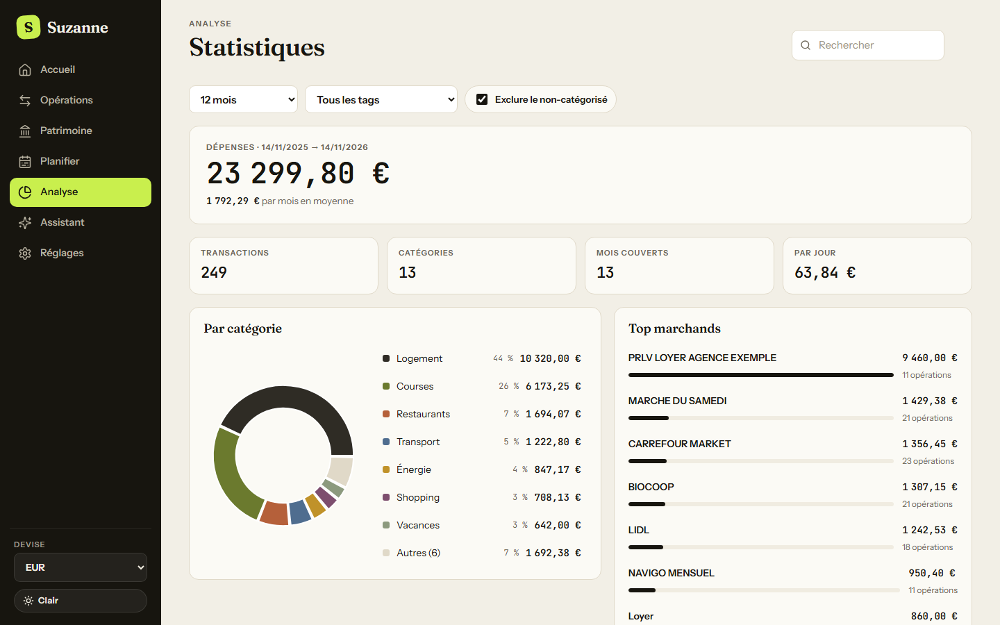<br><sub><b>Statistiques</b> : dépenses par catégorie, top marchands, cashflow et épargne.</sub></td>
<td width="50%">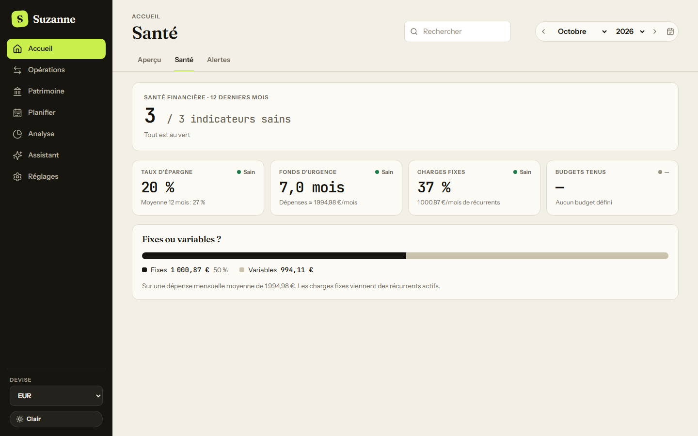<br><sub><b>Santé financière</b> : taux d'épargne, fonds d'urgence, charges fixes et variables.</sub></td>
</tr>
<tr>
<td width="50%">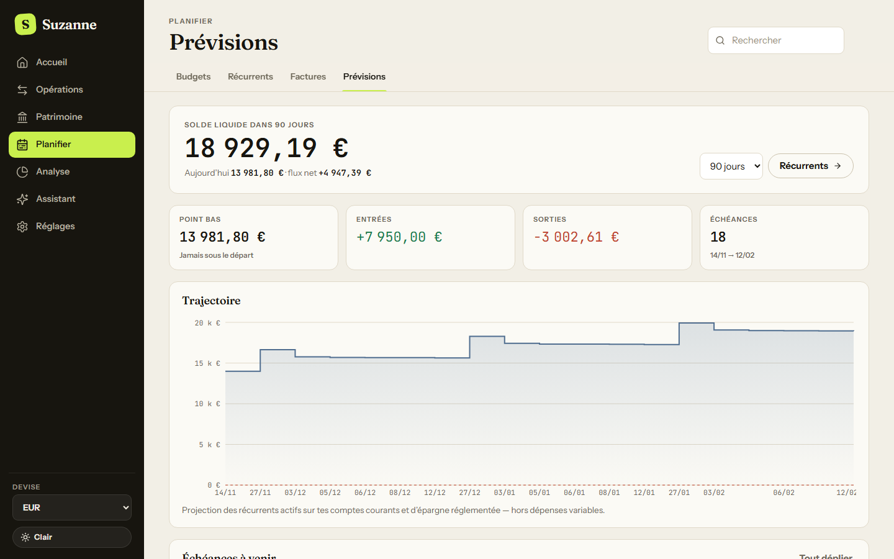<br><sub><b>Prévisions</b> : trajectoire du solde à partir des récurrents, point bas.</sub></td>
<td width="50%">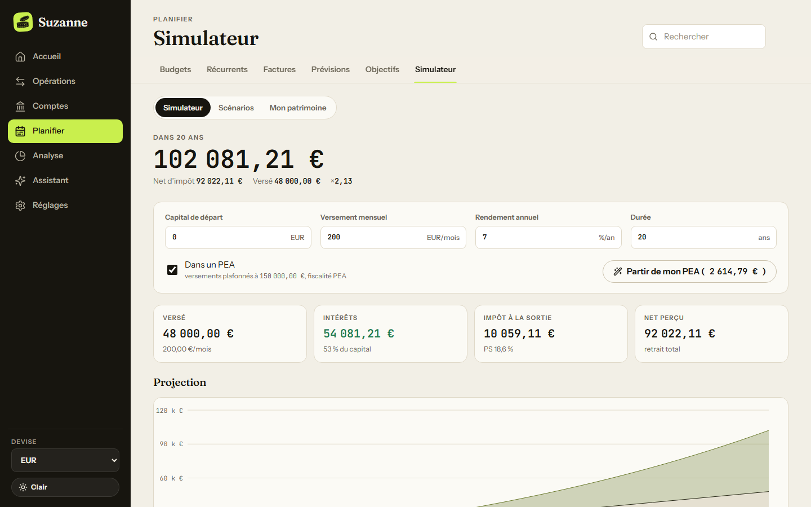<br><sub><b>Simulateur</b> : intérêts composés, plafond et fiscalité du PEA, comparaison de scénarios.</sub></td>
</tr>
</table>

<details>
<summary>Plus de captures (comptes, objectifs, récurrents, factures, à vérifier, catégories, tags, mobile)</summary>


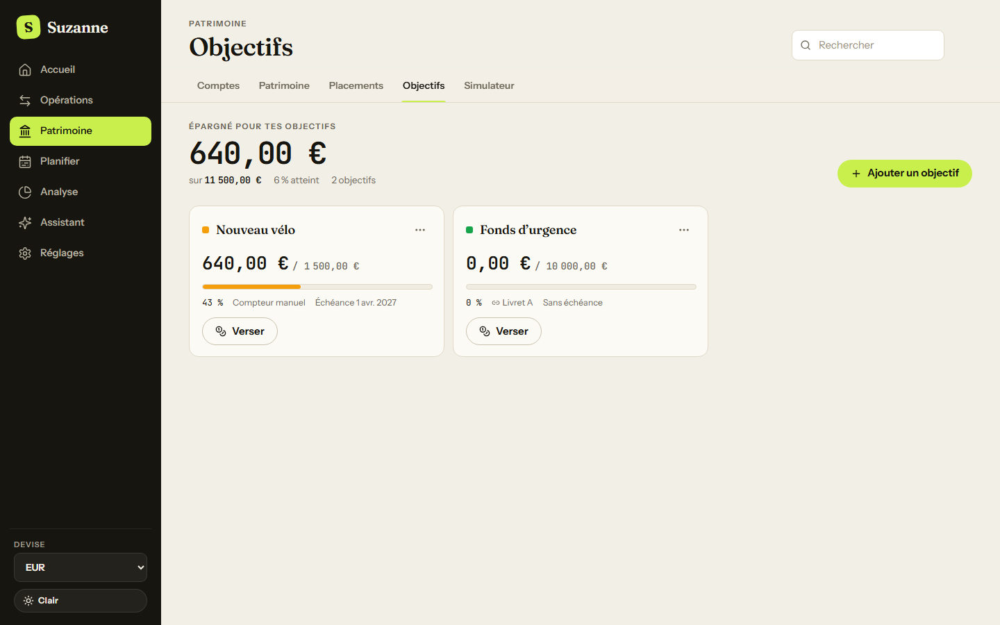


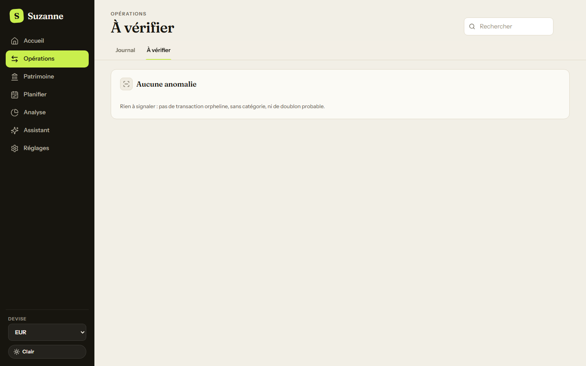
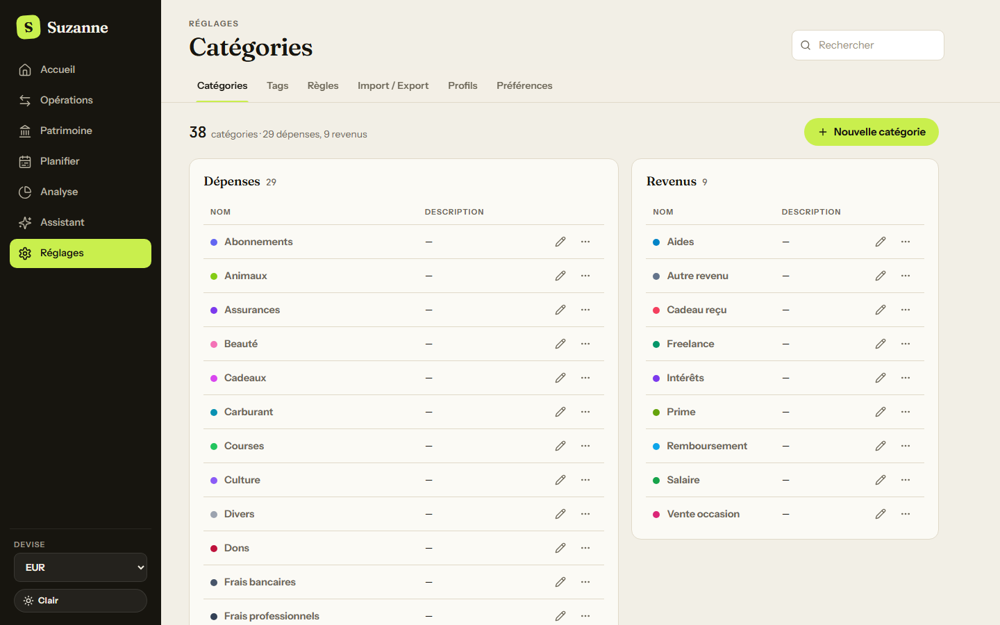
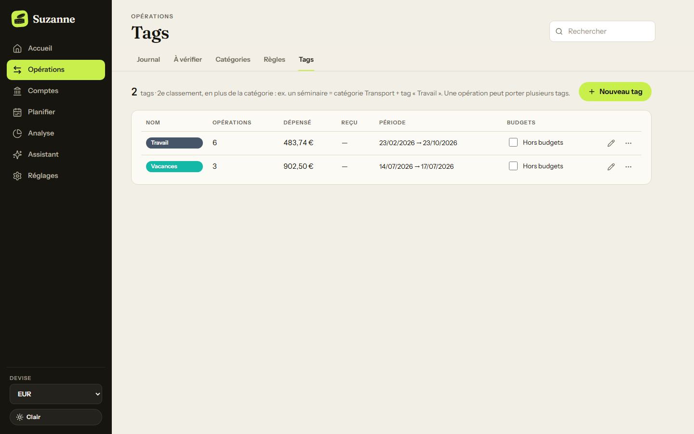

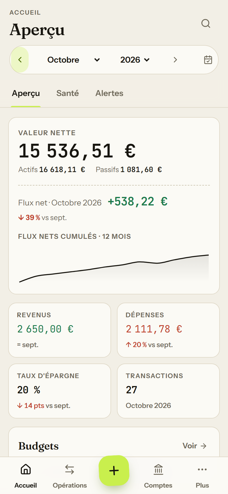 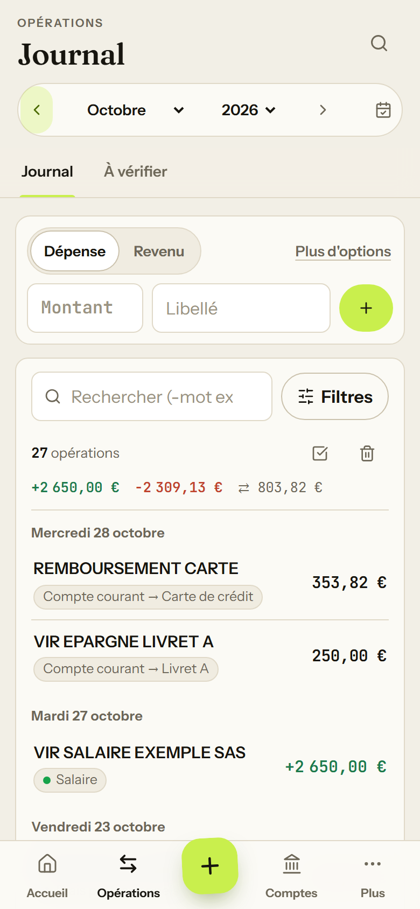

</details>

---

## Sommaire

- [Fonctionnalités](#fonctionnalités)
- [Démarrage rapide](#démarrage-rapide)
- [Commandes](#commandes)
- [Architecture](#architecture)
- [Traductions](#traductions)
- [Données de démonstration et captures](#données-de-démonstration-et-captures)
- [Déploiement](#déploiement)
- [Variables d'environnement](#variables-denvironnement)
- [Sécurité](#sécurité)
- [Documentation](#documentation)
- [Licence](#licence)

---

## Fonctionnalités

**Suivi du quotidien**
- **Journal des opérations** : dépenses, revenus, virements entre comptes ; filtres combinables (type, catégories, comptes, tags, pointage) et recherche avec exclusion (`courses -auchan`) ; édition dans la ligne, actions en lot, corbeille.
- **Ventilation** d'une opération sur plusieurs catégories, **remboursements** 1↔N (un revenu annule tout ou partie d'une ou plusieurs dépenses), **pièces jointes** (reçus, PDF).
- **Catégories** avec description en infobulle, fusion ; **tags** libres avec résumé par tag, filtres de statistiques par tag et exclusion d'un tag des budgets.
- **Règles** : un mot-clé du libellé décide de la catégorie (et/ou d'un tag), à l'import comme rétroactivement.
- **À vérifier** : opérations sans compte ou sans catégorie, doublons probables (validables), suggestions de catégorie.

**Comptes et rapprochement**
- Comptes courants, livrets, PEA, comptes-titres, assurance-vie, crypto, crédits ; institutions, multi-devises (taux de change), archivage.
- **Soldes par relevés** : le solde saisi d'un relevé fait foi ; le **rapprochement** montre, entre deux relevés, si les opérations expliquent l'écart au centime (opération manquante ou en double) et permet un ajustement explicite.
- **Imports bancaires** : CSV configurable (profils de banque, export Boursorama reconnu), OFX, QIF. Doublons ignorés même après renommage (empreinte de la ligne de relevé), virements entre tes comptes reliés automatiquement, garde-fou contre une colonne « solde » prise pour un montant.

**Planifier**
- **Budget du mois** et « reste à vivre » par jour, **enveloppes** par catégorie avec report, plafonds suggérés d'après la médiane des 6 derniers mois, **provisions** pour lisser les grosses dépenses annuelles.
- **Récurrents** (loyer, salaire, abonnements) générés automatiquement, **factures** à fourchette de montant vérifiées chaque mois, **prévisions** du solde, **objectifs** d'épargne.

**Patrimoine et placements**
- Valeur nette et historique, par compte et par type.
- **Positions et ordres** (8 décimales de quantité) valorisés chaque jour aux cours **Yahoo Finance**, recherche de titres ; achat et vente débitent/créditent les espèces du compte.
- **PEA** : versements et plafond, performance pondérée par le temps et annualisée (XIRR), comparaison à un indice, fiscalité à la sortie, récapitulatif annuel imprimable ; **simulateur** d'intérêts composés.

**Le reste**
- **Analyse** : statistiques par catégorie et par marchand, santé financière, alertes (seuil de solde, grosse dépense, relevé manquant).
- **Assistant IA** optionnel (OpenAI ou endpoint compatible, Ollama…) : il lit tes données et propose des actions que tu confirmes.
- **Sauvegardes** : automatique quotidienne (14 gardées) et manuelle, export JSON complet réimportable sans doublon, export sur mesure, CSV pour tableur.
- Plusieurs profils, recherche globale, raccourcis clavier, thème clair / sombre, interface responsive.

## Démarrage rapide

**Prérequis :** Node.js 20+, Docker (pour PostgreSQL).

```bash
npm ci
cp .env.example .env                                  # DATABASE_URL du Postgres de dev
docker compose -f compose.dev.yml up -d postgres      # Postgres sur 127.0.0.1:5434
npm run migrate:deploy                                 # applique les migrations
npm run db:seed                                        # profil « Démo » + catégories de base

npm run dev:backend                                    # API sur :3000
npm run dev:frontend                                   # interface sur http://localhost:5174 (proxy /api → :3000)
```

Le backend tourne avec `tsx` sans rechargement automatique : relance-le après une modification côté serveur. L'interface (Vite) se recharge seule.

## Commandes

| Commande | Rôle |
|---|---|
| `npm run build` | Build `shared` → `frontend` → `backend` (et client Prisma) |
| `npm test` | Tests unitaires (Vitest) |
| `DATABASE_URL=… npm run test:integration` | Tests d'intégration sur une base PostgreSQL **jetable**, dont le test « golden » qui compare tous les chiffres calculés à une référence |
| `npm run i18n:check` | Contrôle des traductions (voir [Traductions](#traductions)) |
| `npm run i18n:extract -- <fichiers>` | Extrait le texte écrit en dur d'écrans pour le passer en clés |
| `npm run screenshots -- <dossier> [pages]` | Captures desktop et mobile ; échoue sur une erreur JavaScript ou un débordement horizontal |
| `npm run migrate:dev` | Nouvelle migration Prisma (dev) |

Sous Windows, lance Vitest depuis PowerShell plutôt que Git Bash.

## Architecture

```
shared/     types et calculs purs partagés (finances PEA, XIRR, taxonomie des comptes)
backend/    API Express 4 + Prisma 7 + PostgreSQL, imports, agrégations, sauvegardes
frontend/   SPA React 18 + Vite + Recharts + i18next
tools/      captures, données de démo, outils de traduction
docs/       guide d'utilisation, architecture du grand livre, décisions (ADR)
```

Principes structurants (détaillés dans [`docs/decisions/`](docs/decisions/)) :

- **Grand livre à lignes** : une opération = un en-tête + des lignes signées `(compte, montant, catégorie)` ; une seule définition de « dépensé / reçu » côté serveur ([ADR 0001](docs/decisions/0001-modele-comptable-a-lignes.md), [architecture](docs/ARCHITECTURE-ledger.md)).
- **Soldes par ancres** : solde = dernier relevé + opérations postérieures ; le relevé fait foi pour le solde, les opérations pour les flux ([ADR 0002](docs/decisions/0002-soldes-par-ancres-et-rapprochement.md)).
- **Identités stables** (UUID) et empreintes d'import : restaurer ou réimporter ne duplique rien ([ADR 0004](docs/decisions/0004-identites-stables-et-empreintes.md), [ADR 0005](docs/decisions/0005-sauvegarde-v3.md)).
- Toutes les routes sont sous `/api/users/:user_id/…` et vérifient que chaque référence appartient à l'utilisateur.

En production, **un seul conteneur** Node sert l'API (`/api/*`), le healthcheck (`/healthz`) et l'interface buildée ; les migrations sont appliquées au démarrage.

## Traductions

Les textes de l'interface sont des **clés stables** (`budgets.budgets.monthly_budget`) rangées dans des catalogues CSV par domaine, `frontend/src/i18n/catalogs/<domaine>.csv`, une ligne par texte avec toutes les langues côte à côte :

```csv
keys,fr,en
ui.nav.home,Accueil,Home
budgets.budgets.monthly_budget,Budget du mois :,Monthly budget:
```

- Le français est la langue source et de repli ; dates, nombres et devises suivent la langue choisie.
- `npm run i18n:check` (en CI) bloque un catalogue mal formé, une clé en double ou une case vide, et liste les clés manquantes ou inutilisées et le texte encore écrit en dur.
- Ajouter une langue : un code dans `frontend/src/i18n/index.ts` et une colonne dans chaque catalogue.

Règles complètes : [ADR 0007](docs/decisions/0007-localisation-cles-et-csv.md).

## Données de démonstration et captures

Les captures du README sont faites sur une base **dédiée et vide**, jamais sur des données réelles :

```bash
DATABASE_URL=postgres://…/suzanne_demo npm run migrate:deploy
DATABASE_URL=postgres://…/suzanne_demo npm run db:seed
# lancer le backend sur cette base, puis :
BASE=http://localhost:3000 node tools/demo-data.mjs     # 12 mois d'un foyer fictif
BASE=http://localhost:5174 npm run screenshots -- captures --month 2026-10
```

`tools/demo-data.mjs` refuse de tourner si le profil « Démo » a déjà des opérations.

## Déploiement

> ⚠️ Suzanne n'a **pas d'authentification intégrée**. Déploie-la derrière un VPN, un reverse-proxy avec authentification, ou sur une interface privée.

`compose.yml` attend un PostgreSQL joignable via `DATABASE_URL` et un réseau Docker externe `proxy`.

```bash
git clone https://github.com/<owner>/suzanne-lite.git suzanne && cd suzanne
cat > .env <<ENV
DATABASE_URL=postgres://suzanne:<mot-de-passe>@postgres:5432/suzanne
APP_TOKEN=<secret-long-et-aléatoire>
NODE_ENV=production
ENV
docker compose up -d --build
docker compose exec -T suzanne sh -c 'cd backend && npx prisma db seed'
curl http://127.0.0.1:3000/healthz        # {"status":"ok","db":true}
```

Exemple Caddy :

```caddy
finance.example.internal {
    tls internal
    reverse_proxy suzanne:3000
}
```

Mise à jour : `git pull && docker compose up -d --build` (migrations appliquées au démarrage).

## Variables d'environnement

| Variable | Défaut | Description |
|---|---|---|
| `DATABASE_URL` | *(requis)* | URL PostgreSQL |
| `PORT` | `3000` | Port HTTP |
| `NODE_ENV` | `development` | `production` en prod (avertit au démarrage si `APP_TOKEN` est vide) |
| `APP_TOKEN` | *(vide)* | Secret partagé exigé sur `/api/*` (`Authorization: Bearer …`) |
| `CORS_ORIGIN` | *(vide)* | Origines autorisées à appeler l'API depuis un autre domaine |
| `AI_PROVIDER` | `openai` | Libellé du fournisseur IA |
| `AI_API_KEY` / `OPENAI_API_KEY` | *(vide)* | Clé de l'assistant IA (aussi réglable dans Préférences) |
| `AI_MODEL` | `gpt-4.1-mini` | Modèle compatible Chat Completions |
| `AI_BASE_URL` | `https://api.openai.com/v1` | Endpoint compatible OpenAI (proxy, Ollama…) |

## Sécurité

- Pas de comptes utilisateurs : toute personne qui atteint l'application voit tous les profils. Usage prévu : personnel, sur réseau privé.
- `APP_TOKEN` ajoute un secret partagé sur l'API ; au premier refus, l'interface le demande et le garde dans le navigateur.
- Ne commite jamais de données réelles : `.env`, exports JSON/CSV, relevés, captures personnelles. Le dépôt ne contient que des données fictives.
- Garde des sauvegardes régulières (automatiques dans l'application, et un export JSON hors de la machine).

## Documentation

- [Guide d'utilisation](docs/UTILISATION.md)
- [Architecture du grand livre](docs/ARCHITECTURE-ledger.md)
- [Décisions d'architecture (ADR)](docs/decisions/README.md)
- [Contribuer](CONTRIBUTING.md)

## Licence

MIT. Voir [LICENSE](LICENSE).
